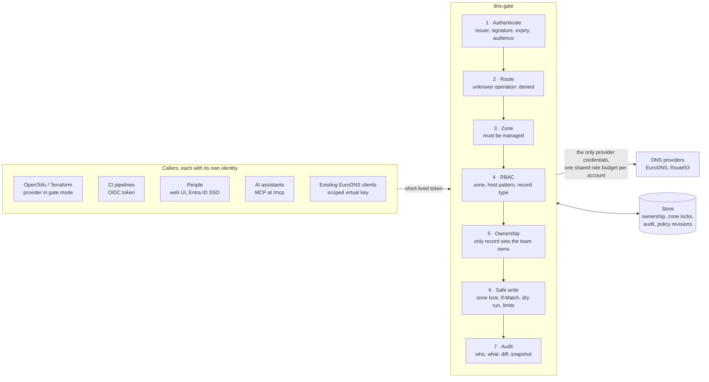
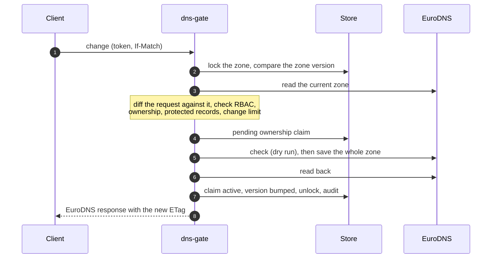

# dns-gate

A security gateway in front of DNS provider APIs: [EuroDNS](https://www.eurodns.com)
today, AWS Route53 next, several accounts of each in one gate.

**How it works, with diagrams: <https://kamorionlabs.github.io/dns-gate/>**

EuroDNS API keys carry no scope: one key reaches every domain, contact, nameserver
profile, subscription and DNS zone of the account; cloud DNS credentials are rarely
scoped finer than a hosted zone. dns-gate holds the provider credentials
alone, authenticates clients with short-lived OIDC tokens and enforces, on every
request:

- **RBAC**: which zone, host pattern and record type a caller may read or write;
- **ownership**: the gate only modifies or deletes RRsets it created (or that an
  admin explicitly adopted), and only for the team that owns them;
- **safe writes**: per-zone lock, `ETag`/`If-Match`, mandatory dry run, protected
  records, blast-radius limits;
- **the upstream rate limit** (EuroDNS: 10 requests per 10 seconds per IP, with
  progressive bans) for all clients combined;
- a full **audit trail**, browsable in a **web UI** (zone inventory with ownership
  status, filterable history with diffs, what the signed-in user may do, and a
  Connect page with ready-to-paste setups for Claude Code, Claude Desktop,
  Terraform and the API);
- an **editable policy** from the UI for designated people: a managed layer of
  revisions on top of the git-managed base file, with approval by another approver,
  atomic activation, rollback, diff and impact analysis. Who may edit or approve is
  only ever decided by the base file, and human access uses Entra ID SSO with app
  roles (`Gate.Reader`, `Gate.Operator`, `Gate.PolicyAdmin`) assigned to groups.

Every zone has a provider-neutral RRset API under `/api/v1`. For EuroDNS zones the
EuroDNS contract stays available too: an existing EuroDNS client works through the
gate by changing its base URL and credentials.

> Status: **beta**. In production since November 2026 for one organization: 14 zones,
> OpenTofu pipelines through the Terraform provider, the web UI and the MCP server.
> Versions are still 0.x: configuration and API may change before 1.0, always with
> a note in the release.

Also included:

- **onboarding of existing zones**: bulk adoption team by team (preview, all-or-nothing
  apply, mandatory comment) and Terraform export with `import` blocks, whose first
  plan must be empty — see [docs/ONBOARDING.md](docs/ONBOARDING.md);
- **zone discovery**: the zones of the provider accounts outside the configured ones
  are listed read-only and brought under management from the UI by a reviewed
  policy revision, without a redeploy — see [docs/CONFIG.md](docs/CONFIG.md#zone-discovery);
- **one binding for many pipelines**: the owner team derived from a claim
  (`team_from`), so each pipeline matched by a glob owns its own records — see
  [docs/CONFIG.md](docs/CONFIG.md#team-derived-from-a-claim);
- an **MCP server** at `/mcp` for LLM agents, with the same authentication, RBAC and
  ownership: read tools by default, writes only if enabled and always through a plan
  then an apply bound to that plan. Claude Desktop users install it from the Connect
  page as a one-click extension that signs them in through the browser, without a
  terminal or any runtime to install — see [docs/CONFIG.md](docs/CONFIG.md#claude-desktop-extension).

## Related repositories

| Repository | Role |
|---|---|
| [eurodns-go](https://github.com/KamorionLabs/eurodns-go) | Go client, RRset helpers, zone delta, fake server. Used by the gate and the provider. |
| **dns-gate** | This gateway, container image, Helm chart. |
| [terraform-provider-eurodns](https://github.com/KamorionLabs/terraform-provider-eurodns) | One Terraform/OpenTofu provider, direct to EuroDNS or through the gate. |

## How it works



Three layers of protection: the provider credential scope (upstream), RBAC and
ownership (gate). Every write, whatever the client sent, is computed against the zone
as it is now (at EuroDNS, one checked save of the whole zone):



Details in [docs/DESIGN.md](docs/DESIGN.md) and on the
[project site](https://kamorionlabs.github.io/dns-gate/).

## Authentication

Clients present a short-lived OIDC token whose audience is the gate. Supported
issuers include AWS IAM outbound identity federation (`sts:GetWebIdentityToken`),
GitHub Actions, GitLab CI, Kubernetes service accounts and **Entra ID**:

- Managed Identity, AKS Workload Identity, or an Azure DevOps service connection in
  workload identity federation mode obtain an Entra access token for the gate's app
  registration (`api://<gate-app>/.default`);
- bindings use app roles (`roles` claim, not groups), the subject is `tid`+`oid`,
  the actor category comes from `idtyp`;
- tenant-specific issuers only (`/common` is refused).

Azure DevOps pipelines can also present the OIDC token Azure DevOps issues for a
service connection, without any cloud login. Its audience (`api://AzureADTokenExchange`)
is shared by every service connection of the organization, so the gate only trusts it
bound to the exact subjects of service connections dedicated to the gate — see
[docs/CONFIG.md](docs/CONFIG.md#azure-devops-oidc).

Existing EuroDNS clients (ACME) can use scoped virtual keys instead. Details in
[docs/DESIGN.md](docs/DESIGN.md#9-authentication).

## Quickstart (local)

```sh
export EURODNS_APP_ID=...   # EuroDNS credentials of the "eurodns" provider,
export EURODNS_API_KEY=...  # held by the gate only
go run ./cmd/dns-gate --config examples/config.yaml
```

Then point a client at `http://localhost:8080` with a token from one of the issuers
declared in the config. Configuration reference: [docs/CONFIG.md](docs/CONFIG.md).

Kubernetes: Helm chart in `charts/dns-gate`.

## Documentation

- [Design](docs/DESIGN.md)
- [Configuration reference](docs/CONFIG.md)
- [Migrating a 0.x configuration to providers](docs/MIGRATION-0.x.md)
- [Threat model](docs/THREAT-MODEL.md)
- [ACME / certificates](docs/ACME.md)
- [Onboarding existing zones](docs/ONBOARDING.md)
- [Roadmap and points to validate](docs/ROADMAP.md)

## License

MIT — see [LICENSE](LICENSE).
