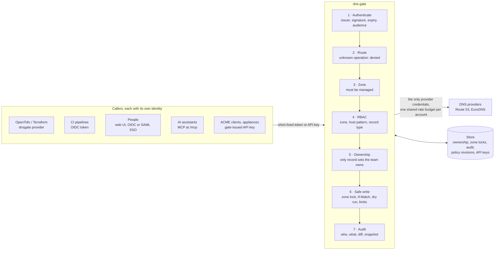
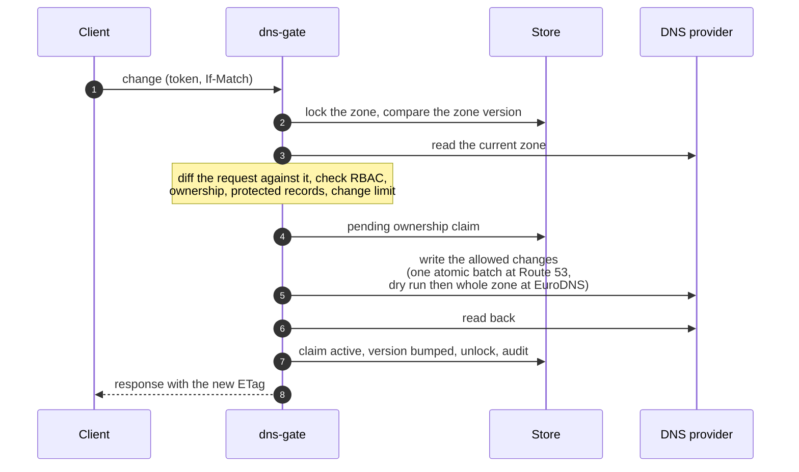

# dns-gate

A security gateway in front of DNS provider APIs: today
[Amazon Route 53](docs/providers/route53.md) and [EuroDNS](https://www.eurodns.com),
several accounts of each in one gate, other providers on the
[roadmap](https://github.com/KamorionLabs/dns-gate/issues). Clients see one
provider-neutral API whatever the provider of a zone.

**How it works, with diagrams: <https://kamorionlabs.github.io/dns-gate/>**

Provider credentials are coarse: a EuroDNS API key reaches every domain, contact,
nameserver profile and subscription of the account, and cloud DNS credentials are
rarely scoped finer than a hosted zone, with no notion of who created a record.
dns-gate holds the provider credentials alone, authenticates clients with short-lived
OIDC tokens and enforces, on every request:

- **RBAC**: which zone, host pattern and record type a caller may read or write;
- **ownership**: the gate only modifies or deletes RRsets it created (or that an
  admin explicitly adopted), and only for the team that owns them;
- **safe writes**: per-zone lock, `ETag`/`If-Match`, the provider dry run when it has
  one, protected records, blast-radius limits;
- **the upstream rate limits** for all clients combined: one rate-limited transport
  per EuroDNS account (10 requests per 10 seconds per IP, with progressive bans),
  adaptive retry on Route 53 throttling;
- a full **audit trail**, browsable in a **web UI** (zone inventory with ownership
  status and provider, filterable history with diffs, what the signed-in user may
  do, DNS changes staged then applied as a reviewed plan, and a Connect page with
  ready-to-paste setups for Claude Code, Claude Desktop, Terraform and the API, and
  an API token for the signed-in user);
- an **editable policy** from the UI for designated people: a managed layer of
  revisions on top of the git-managed base file, with approval by another approver,
  atomic activation, rollback, diff and impact analysis. Who may edit or approve is
  only ever decided by the base file; people sign in with OIDC (for example Entra ID
  app roles assigned to groups) or SAML.

Every zone has a provider-neutral RRset API under `/api/v1` (read, `PUT`/`DELETE` with
content-hash preconditions, plan/apply), used by the
[dnsgate Terraform provider](https://github.com/KamorionLabs/terraform-provider-dnsgate),
the UI and the MCP server — see the [API guide](docs/API.md) and the
[API reference](https://kamorionlabs.github.io/dns-gate/api.html). For EuroDNS zones
the EuroDNS contract stays available too: an existing EuroDNS client works through
the gate by changing its base URL and credentials.

> Status: **beta**. In production since November 2026 for one organization: 14 zones,
> OpenTofu pipelines through the Terraform provider, the web UI and the MCP server.
> Versions are still 0.x: configuration and API may change before 1.0, always with
> a note in the release.

Also included:

- **onboarding of existing zones**: bulk adoption team by team (preview, all-or-nothing
  apply, mandatory comment) and Terraform export with `import` blocks, whose first
  plan must be empty — see [docs/ONBOARDING.md](docs/ONBOARDING.md);
- **zone discovery**: the zones of the provider accounts outside the configured ones
  are listed read-only and brought under management from the UI by a reviewed
  policy revision, without a redeploy — see [docs/CONFIG.md](docs/CONFIG.md#zone-discovery);
- **EuroDNS folders**: role rules select zones by EuroDNS folder (`folders: ["/ES/**"]`)
  as well as by name, with the folder shown in the UI, the API and MCP and every move
  audited — see [docs/CONFIG.md](docs/CONFIG.md#eurodns-folders);
- **one binding for many pipelines**: the owner team derived from a claim
  (`team_from`), so each pipeline matched by a glob owns its own records — see
  [docs/CONFIG.md](docs/CONFIG.md#team-derived-from-a-claim);
- an **MCP server** at `/mcp` for LLM agents, with the same authentication, RBAC and
  ownership: read tools by default, writes only if enabled and always through a plan
  then an apply bound to that plan. Claude Desktop users install it from the Connect
  page as a one-click extension that signs them in through the browser, without a
  terminal or any runtime to install — see [docs/CONFIG.md](docs/CONFIG.md#claude-desktop-extension).

## Related repositories

| Repository | Role |
|---|---|
| [eurodns-go](https://github.com/KamorionLabs/eurodns-go) | EuroDNS Go client, RRset helpers, zone delta, fake server. Used by the gate's EuroDNS adapter and the EuroDNS Terraform provider. |
| **dns-gate** | This gateway, container image, Helm chart. |
| [terraform-provider-dnsgate](https://github.com/KamorionLabs/terraform-provider-dnsgate) | Terraform/OpenTofu provider of the gate API (`dnsgate_record_set`, delegated roles and bindings), for every provider behind the gate. |
| [terraform-provider-eurodns](https://github.com/KamorionLabs/terraform-provider-eurodns) | Terraform/OpenTofu provider of the EuroDNS API, direct to EuroDNS or through the gate's EuroDNS-compatible API. |

## How it works



Three layers of protection: the provider credential scope (upstream), RBAC and
ownership (gate). Every write, whatever the client sent, is computed against the zone
as it is now:



Details in [docs/DESIGN.md](docs/DESIGN.md) and on the
[project site](https://kamorionlabs.github.io/dns-gate/).

## Authentication

Clients present a short-lived OIDC token whose audience is the gate. Supported
issuers include AWS IAM outbound identity federation (`sts:GetWebIdentityToken`),
GitHub Actions, GitLab CI, Kubernetes service accounts and **Entra ID**:

- Managed Identity, AKS Workload Identity, or an Azure DevOps service connection in
  workload identity federation mode obtain an Entra access token for the gate's app
  registration (`api://<gate-app>/.default`);
- bindings use app roles (`roles` claim, not groups), the subject is `tid`+`oid`,
  the actor category comes from `idtyp`;
- tenant-specific issuers only (`/common` is refused).

Azure DevOps pipelines can also present the OIDC token Azure DevOps issues for a
service connection, without any cloud login. Its audience (`api://AzureADTokenExchange`)
is shared by every service connection of the organization, so the gate only trusts it
bound to the exact subjects of service connections dedicated to the gate — see
[docs/CONFIG.md](docs/CONFIG.md#azure-devops-oidc).

People sign in to the UI with OIDC (Entra ID or any OIDC provider) or SAML 2.0, for
example AWS IAM Identity Center with its groups. When the gate is its own issuer, a
signed-in user gets a short-lived gate token for curl or Terraform from the Connect
page, and Claude Desktop signs in through the gate's OAuth endpoints — see
[docs/IDENTITY-CENTER.md](docs/IDENTITY-CENTER.md).

Clients that keep a credential longer than their CI or workload token lasts
(certbot and acme.sh hooks, scripts) exchange that token for a short-lived gate token
(`POST /api/v1/token-exchange`, RFC 8693, opt-in per issuer with
`token_exchange: true`, see [docs/CONFIG.md](docs/CONFIG.md#token-exchange)). Third
parties without any OIDC identity (a hosting provider, an appliance) get gate-issued
API keys (`dgk_…`): bound to a team and a role, stored hashed, rotated with an
overlap and revoked through `/api/v1/api-keys` by holders of `gate.apikey.manage`,
see [docs/API.md](docs/API.md). certbot, acme.sh, lego, Traefik, win-acme,
cert-manager and Caddy solve DNS-01 challenges through the gate's lego httpreq and
acme-dns endpoints, unmodified, on any provider and without CNAME: see
[docs/ACME.md](docs/ACME.md). Static virtual keys from the configuration remain for
existing EuroDNS clients. Details in [docs/DESIGN.md](docs/DESIGN.md#9-authentication).

## Quickstart (local)

The example configuration fronts one EuroDNS account:

```sh
export EURODNS_APP_ID=...   # EuroDNS credentials of the "eurodns" provider,
export EURODNS_API_KEY=...  # held by the gate only
go run ./cmd/dns-gate --config examples/config.yaml
```

Then point a client at `http://localhost:8080` with a token from one of the issuers
declared in the config. Configuration reference: [docs/CONFIG.md](docs/CONFIG.md).

A Route 53 account is one more entry in `providers` (`kind: route53`, AWS credentials
from the default chain, optionally an assumed role): see
[docs/providers/route53.md](docs/providers/route53.md).

Deployment: a container (Helm chart in `charts/dns-gate`) with a memory, SQLite,
Postgres or DynamoDB store, or an AWS Lambda function behind API Gateway (low volume,
Route 53, DynamoDB store, configuration from S3 or SSM):
[docs/DEPLOY-LAMBDA.md](docs/DEPLOY-LAMBDA.md).

## Documentation

- [API guide](docs/API.md) and [API reference](https://kamorionlabs.github.io/dns-gate/api.html) ([OpenAPI](api/dns-gate.openapi.yaml)), including API keys
- [ACME / certificates](docs/ACME.md)
- [Onboarding existing zones](docs/ONBOARDING.md)
- [Configuration reference](docs/CONFIG.md)
- [Route 53 provider](docs/providers/route53.md)
- [SAML login with AWS IAM Identity Center, gate tokens](docs/IDENTITY-CENTER.md)
- [Deploying on AWS Lambda](docs/DEPLOY-LAMBDA.md)
- [Migrating a 0.x configuration to providers](docs/MIGRATION-0.x.md)
- [Design](docs/DESIGN.md)
- [Threat model](docs/THREAT-MODEL.md)
- [Roadmap and points to validate: GitHub issues](https://github.com/KamorionLabs/dns-gate/issues)

## License

MIT — see [LICENSE](LICENSE).
