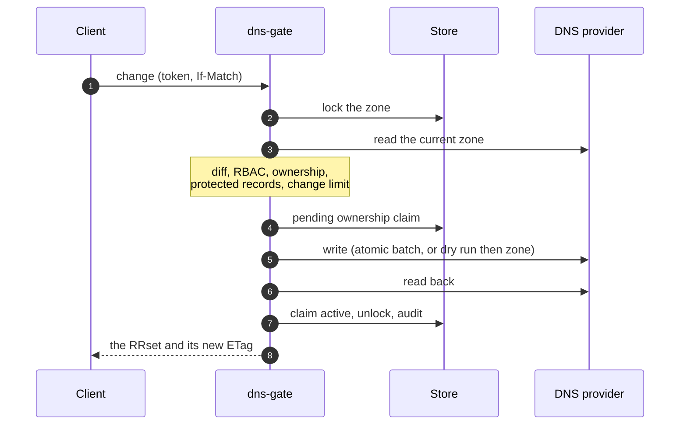

# Teams and ownership

RBAC says what a caller may touch; **ownership** says which existing records it may
change. Every record set written or adopted through the gate is owned by a **team**,
and only that team's members change or delete it. Pipelines and teams with the same
role therefore cannot overwrite each other.

## Teams

```yaml
teams:
  web:
    description: Web site, people and pipelines
    members:
      groups: [dns-web]
      subjects:
        - issuer: github
          claims: {sub: ["repo:example/web:*"]}

bindings:
  - role: web-records
    team: web          # the members of web get web-records, acting for web
```

- A binding names the team that will own what its subjects create.
- `team_from` derives the team from a claim, so one binding covers many pipelines,
  each owning its own records (team `gh-<repository>` from the GitHub `sub`). See
  [team derived from a claim](../CONFIG.md#team-derived-from-a-claim) and its
  trade-off: any identity matching the glob may **create** what the role allows.
- Once a `teams` block exists, a binding to an undeclared team is refused: a typo
  never silently creates a team.
- A caller in several teams writes for the first one (its default team) and picks
  another with `X-DNS-Gate-Team` or the `team` of a plan.

## Record states

| State | Meaning | Who may change it |
|---|---|---|
| **managed** | created or adopted through the gate, unchanged since | its team |
| **foreign** | existed before the gate | nobody, until adopted |
| **tainted** / **missing** | changed or deleted outside the gate | nobody, until adopted again |
| **pending** | a write is in flight; the next reconcile settles it | nobody meanwhile |
| **protected** | matches a protected entry | nobody, ever |

The gate reconciles every managed zone (`reconcile_interval`, 15 minutes) to detect
drift.

## Adoption

An administrator with `dns.record.adopt` adopts foreign records for a team: preview,
then an all-or-nothing adoption with a comment. With `dns.ownership.approve` they may
adopt for a team they are not in. See [Adopt and transfer](../api/ownership.md) and
the [onboarding guide](../ONBOARDING.md) for a whole zone, down to an empty first
Terraform plan.

## Tombstones

Deleting a record leaves a **tombstone** for `ownership.tombstone_ttl` (7 days): only
the team that owned it may create or adopt it again. Another team cannot grab a
freshly deleted name: it asks for a transfer. ACME challenge records
(ephemeral roles) leave none.

## Transfers

Records move between teams by a **transfer**: requested by a member of either team,
approved by someone allowed to write them through the owner team (or holding
`dns.ownership.approve`), a human with a recent login. Settings:

| Setting | Default | Effect |
|---|---|---|
| `ownership.require_second_approver` | `false` | the approver must be another person, recommended as soon as two people administer the gate |
| `ownership.transfer_ttl` | `168h` | a request without a decision expires |
| `ownership.machine_approvers` | `false` | let pipelines approve (weakens the two-person rule) |

A team **rename** moves every record and tombstone of a team, for reorganizations.
Details: [ownership configuration](../CONFIG.md#ownership).

## Safe writes

Whatever the client sent, a write is computed against the zone as it is now:



More in the [design](../DESIGN.md#6-ownership-model).
