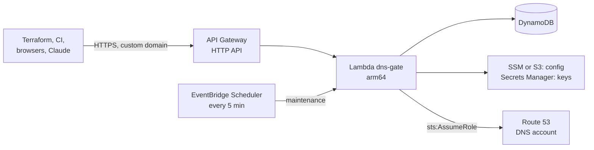

# AWS Lambda

The same binary runs as an AWS Lambda function behind an API Gateway HTTP API, with a
DynamoDB store: no cluster, no load balancer, no NAT, about 1 to 3 USD a month. The
Terraform module [terraform-aws-dns-gate](https://github.com/KamorionLabs/terraform-aws-dns-gate)
creates all of it.

!!! warning "Route 53, not EuroDNS"
    Lambda suits a low-volume gate in front of **Route 53**. In front of EuroDNS,
    whose rate limit is per source IP, run the [container](helm.md): each Lambda
    environment has its own limiter and AWS-pool egress IP.
    [Why](../DEPLOY-LAMBDA.md#why-not-in-front-of-eurodns).



## 1. Get the package

Each release attaches `dns-gate_<version>_lambda_arm64.zip` and its checksum:

```sh
VERSION=0.8.1
gh release download "v${VERSION}" -R KamorionLabs/dns-gate -p "dns-gate_${VERSION}_lambda_arm64.zip*"
sha256sum -c "dns-gate_${VERSION}_lambda_arm64.zip.sha256"   # shasum -a 256 -c on macOS
```

## 2. Use the module

The gate runs in a shared services account; the hosted zones live in a DNS account,
reached through a role that only allows changes to the listed zones (and denies apex
`NS`/`SOA` changes even if the gate is wrong).

```hcl
module "route53_access" {
  source    = "github.com/KamorionLabs/terraform-aws-dns-gate//modules/route53-access"
  providers = { aws = aws.dns }

  gate_role_arns  = [module.dns_gate.lambda_role_arn]
  external_id     = "dns-gate"
  hosted_zone_ids = ["Z0123456789EXAMPLEAAA"]
}

module "dns_gate" {
  source    = "github.com/KamorionLabs/terraform-aws-dns-gate"
  providers = { aws = aws.shared }

  name            = "dns-gate"
  lambda_zip_path = "${path.module}/dns-gate_0.8.1_lambda_arm64.zip"

  config_yaml = templatefile("${path.module}/config.yaml.tftpl", {
    table           = "dns-gate"
    assume_role_arn = module.route53_access.role_arn
    external_id     = "dns-gate"
  })
  route53_role_arns = [module.route53_access.role_arn]

  domain_name        = "dns-gate.example.com"
  create_certificate = true
}
```

Create the alias record of `dns-gate.example.com` to the module outputs
`domain_target_domain_name` and `domain_hosted_zone_id`, in the account owning the zone.

## 3. Write the configuration

The module stores `config_yaml` in SSM (or S3 beyond 8 KB) and replaces the execution
environments when it changes. On Lambda:

```yaml
store:
  type: dynamodb
  dynamodb: {table: ${table}}
providers:
  - id: route53
    kind: route53
    route53:
      assume_role_arn: ${assume_role_arn}
      external_id: ${external_id}
zones: [example.com]
lock:
  wait: 20s            # API Gateway ends requests after 30 s
issuers:
  - name: github
    issuer: https://token.actions.githubusercontent.com
    audiences: [dns-gate]
    bound_claims: {repository_owner: [example]}
# roles, bindings, protected, ui, mcp: as anywhere else
```

- `store.type` must be `dynamodb`; `listen` is ignored and `listen.trusted_proxies`
  stays empty (the client address comes from API Gateway).
- `ui.redirect_url`, `ui.saml.acs_url` and `mcp.public_url` use the custom domain.

## 4. Set the secrets

The module creates one Secrets Manager secret with placeholders and never stores the
values in the Terraform state. Its keys are environment variable names, loaded at
startup:

```sh
jq -n --arg session "$(openssl rand -hex 32)" \
      --rawfile signing token-signing-key.pem \
  '{DNS_GATE_SESSION_KEY: $session, DNS_GATE_TOKEN_SIGNING_KEY: $signing}' > secrets.json
aws secretsmanager put-secret-value --secret-id dns-gate --secret-string file://secrets.json
rm secrets.json
```

`token-signing-key.pem` comes from `openssl genpkey -algorithm EC -pkeyopt ec_paramgen_curve:P-256`.
New values reach new execution environments only: change the configuration or run
`aws lambda update-function-configuration` to force them.

For the human login with IAM Identity Center, the sub-module
`modules/identity-center-saml-app` manages the SAML application assignments:
[SAML with IAM Identity Center](../IDENTITY-CENTER.md).

## 5. Check and upgrade

```sh
curl -fsS https://dns-gate.example.com/healthz
curl -fsS https://dns-gate.example.com/.well-known/dns-gate
```

To upgrade, download the new zip, read the release notes for configuration changes,
point `lambda_zip_path` at it and `terraform plan`: only the function (and the
configuration, if changed) should move. Roll back with the previous zip.

How the background work (reconcile, discovery, transfers) runs between requests, the
IAM permissions and the costs: [Lambda architecture and costs](../DEPLOY-LAMBDA.md).
