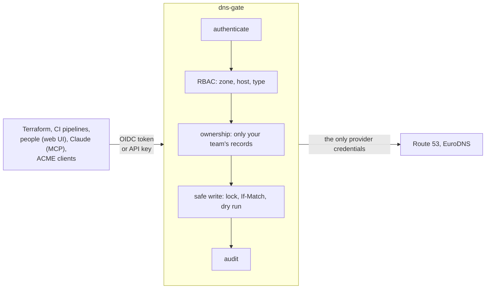

# dns-gate

dns-gate is a security gateway in front of DNS provider APIs (Amazon Route 53 and
EuroDNS today). It holds the provider credentials alone. Teams, pipelines, AI
assistants and third parties change DNS through it with **their own short-lived
identity**, and only the records they own.

On every request the gate checks **who** is calling (OIDC, SAML, gate-issued tokens
and API keys), **what** they may touch (zone, host pattern, record type), whether
their **team owns** the record set, and writes **safely** (per-zone lock,
content-hash preconditions, the provider dry run, protected records, blast-radius
limits, one shared rate budget per provider account). Every decision lands in an
audit journal with diffs.

-   **Get started**

    ---

    Run a gate on your machine in five minutes, with a sandbox DNS provider and
    identity provider, then call it with curl, Python, Terraform or Claude.

    [Quickstart](quickstart.md)

-   **Deploy**

    ---

    Kubernetes with the Helm chart (memory, SQLite, Postgres or DynamoDB store),
    or AWS Lambda behind API Gateway with the Terraform module.

    [Helm](deploy/helm.md) · [AWS Lambda](deploy/lambda.md)

-   **Concepts**

    ---

    Identities, roles and rules, teams, record ownership, tombstones, transfers
    and protected records: the model in three short pages.

    [Identities](concepts/identities.md) · [Roles](concepts/policy.md) · [Ownership](concepts/ownership.md)

-   **API**

    ---

    Task-oriented examples in shell, PowerShell, Python, Node.js, Terraform and
    MCP, and the interactive OpenAPI reference.

    [API by example](api/index.md) · [Reference](https://kamorionlabs.github.io/dns-gate/api.html)

-   **Integrations**

    ---

    The Terraform providers, CI pipelines (GitHub, GitLab, Azure DevOps, AWS),
    Claude through MCP, ACME clients and third parties.

    [Terraform](integrations/terraform.md) · [MCP](integrations/mcp.md) · [Certificates](integrations/certificates.md)

-   **Reference**

    ---

    Every configuration field, the API guide, the design and the threat model.

    [Configuration](CONFIG.md) · [Design](DESIGN.md) · [Threat model](THREAT-MODEL.md)

## Why a gate

Provider credentials are coarse. A EuroDNS API key reaches every domain, contact and
subscription of the account; cloud DNS credentials are rarely scoped finer than a
hosted zone and know nothing of teams or of who created a record. Handing them to
every pipeline, ACME client and contractor means each of them can wipe a zone.

With dns-gate:

- nobody but the gate holds a provider credential;
- a pipeline gets a narrow role (`*.apps` CNAMEs in `example.com`, say) bound to its
  OIDC identity, nothing to store or rotate;
- a team can only change or delete what it created or adopted, so pipelines and
  teams cannot overwrite each other;
- apex NS, MX, CAA and other **protected** records are refused to everyone;
- every change is audited with who, what, the diff and the provider snapshot, in
  ECS or OCSF for your SIEM, with a tamper-evident hash chain;
- after a change, the propagation check shows which name servers and resolvers
  around the world already answer it.

!!! note "Status"
    Beta, versions 0.x: configuration and API may still change before 1.0, always
    with a note in the release. In production since November 2026.

## Related repositories

| Repository | Role |
|---|---|
| [terraform-provider-dnsgate](https://github.com/KamorionLabs/terraform-provider-dnsgate) | Terraform/OpenTofu provider of the gate API, for every DNS provider behind the gate. |
| [terraform-provider-eurodns](https://github.com/KamorionLabs/terraform-provider-eurodns) | EuroDNS provider, direct or through the gate's EuroDNS-compatible API. |
| [terraform-aws-dns-gate](https://github.com/KamorionLabs/terraform-aws-dns-gate) | Terraform module deploying the gate on AWS Lambda. |
| [eurodns-go](https://github.com/KamorionLabs/eurodns-go) | EuroDNS Go client, used by the gate and the EuroDNS provider. |
